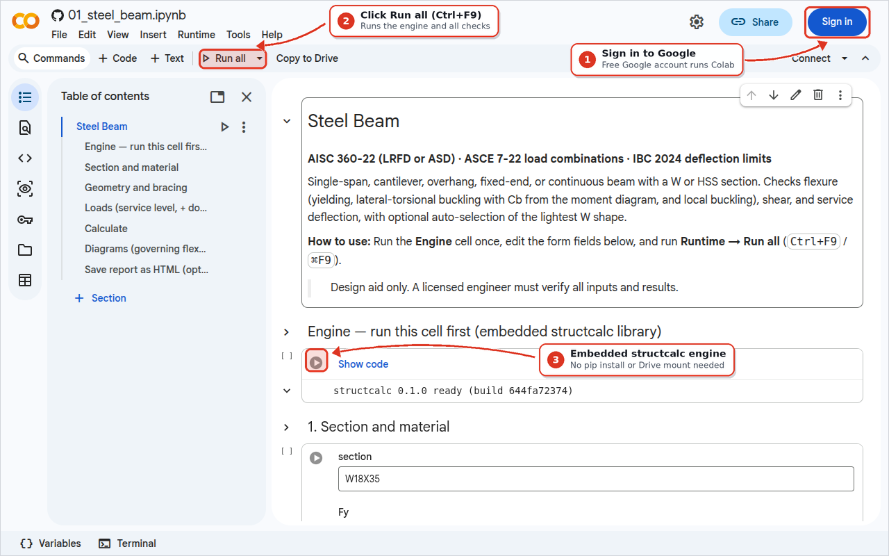
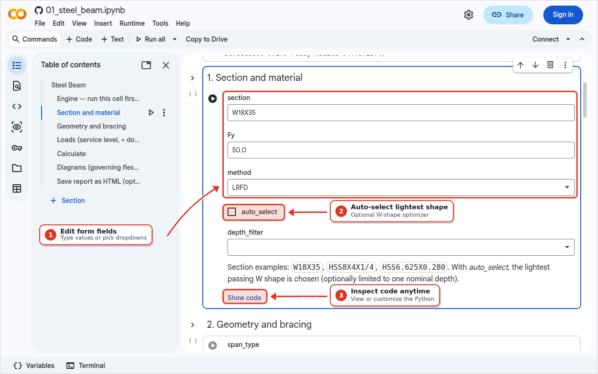
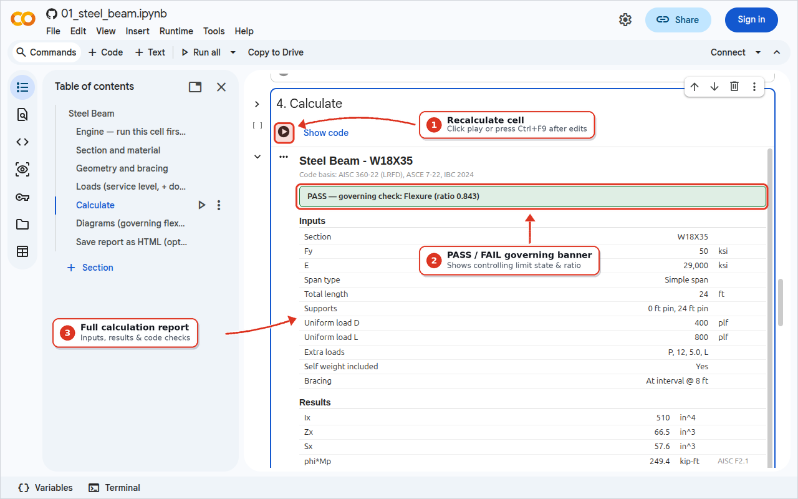
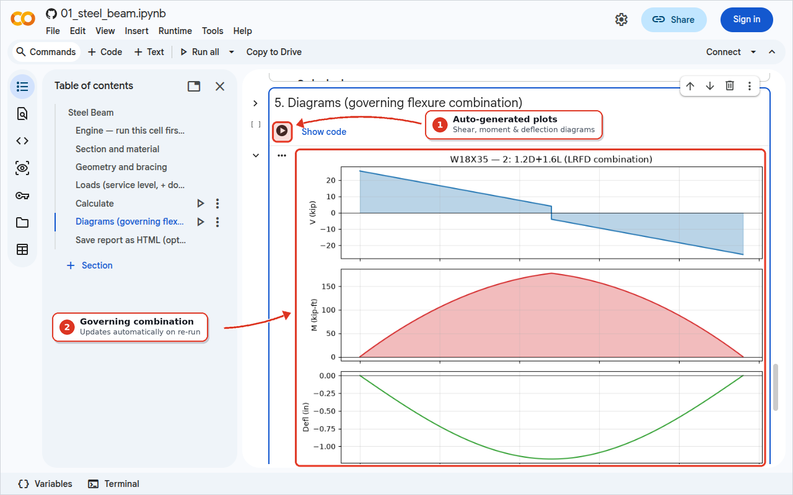
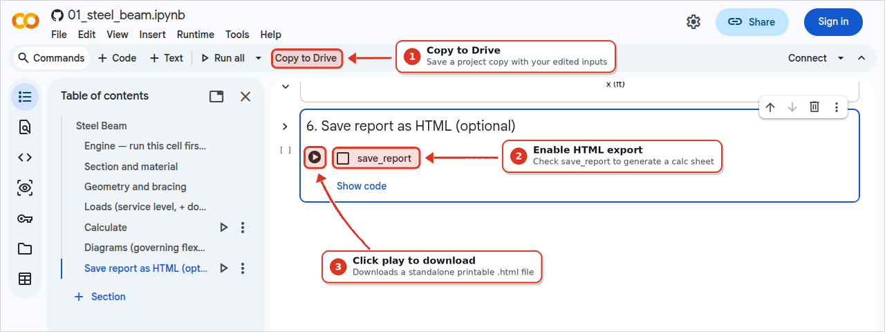

# Structural Calculations

A suite of **15 standalone Google Colab structural engineering calculation notebooks** built on a shared, unit-tested Python calculation engine (`structcalc`).

Every notebook embeds the full `structcalc` library and AISC Shapes Database v16.0 directly inside a collapsed setup cell—no `pip install`, no Google Drive mount, and no local Python environment required. Click any **Open in Colab** badge below to run a calculation sheet right in your browser.

> **Engineering disclaimer:** These notebooks are independent design aids and are not affiliated with or endorsed by any commercial structural engineering software vendor. A licensed structural engineer must independently review and verify all inputs, assumptions, code provisions, and results before use.

---

## Calculation Modules

All notebooks use **US customary units** (`kip`, `ft`, `in`, `ksi`/`psi`, `plf`/`psf`) and current US building codes (**IBC 2024**, **ASCE 7-22**, **AISC 360-22**, **NDS 2024**, **SDPWS 2021**, **ACI 318-19**).

| # | Module | Colab | Code Basis | Key Checks & Outputs |
| :-: | :--- | :---: | :--- | :--- |
| 01 | [Steel Beam](notebooks/01_steel_beam.ipynb) | [](https://colab.research.google.com/github/andrewcoul/structural-calculations/blob/main/notebooks/01_steel_beam.ipynb) | AISC 360-22 (LRFD/ASD), ASCE 7-22, IBC 2024 | W & HSS flexure (yielding, LTB with diagram $C_b$, local buckling), shear, service deflection, lightest W auto-select, V/M/deflection plots |
| 02 | [Steel Column](notebooks/02_steel_column.ipynb) | [](https://colab.research.google.com/github/andrewcoul/structural-calculations/blob/main/notebooks/02_steel_column.ipynb) | AISC 360-22 (LRFD/ASD), ASCE 7-22 | W & HSS axial compression/tension, flexural/torsional/slender buckling, biaxial H1.1 interaction, nonsway $B_1$ amplification, lightest W auto-select |
| 03 | [Wood Beam](notebooks/03_wood_beam.ipynb) | [](https://colab.research.google.com/github/andrewcoul/structural-calculations/blob/main/notebooks/03_wood_beam.ipynb) | NDS 2024 (ASD/LRFD), ASCE 7-22, IBC 2024 | Sawn lumber, glulam, and generic LVL/PSL; bending ($C_L$, $C_V$), shear, bearing, creep deflection ($K_{cr}$), per-combo $C_D$/$\lambda$, auto-select |
| 04 | [Wood Column / Stud](notebooks/04_wood_column.ipynb) | [](https://colab.research.google.com/github/andrewcoul/structural-calculations/blob/main/notebooks/04_wood_column.ipynb) | NDS 2024 (ASD/LRFD), ASCE 7-22 | Sawn, built-up nailed, glulam, and SCL columns/studs; $C_P$, slenderness $l_e/d \le 50$, combined axial + biaxial bending + wind, plate bearing |
| 05 | [Concrete Beam](notebooks/05_concrete_beam.ipynb) | [](https://colab.research.google.com/github/andrewcoul/structural-calculations/blob/main/notebooks/05_concrete_beam.ipynb) | ACI 318-19, ASCE 7-22 (LRFD), IBC 2024 | Rectangular or T-beam; strain-compatibility doubly reinforced flexure ($\pm M$), shear with size effect, stirrup/bar spacing, crack control, $I_e$ & long-term deflection |
| 06 | [Concrete Column](notebooks/06_concrete_column.ipynb) | [](https://colab.research.google.com/github/andrewcoul/structural-calculations/blob/main/notebooks/06_concrete_column.ipynb) | ACI 318-19, ASCE 7-22 (LRFD) | Rectangular/circular tied or spiral; strain-compatibility $P$–$M$ interaction plots, nonsway moment magnification, Bresler biaxial check, tie/spiral detailing |
| 07 | [General Footing](notebooks/07_general_footing.ipynb) | [](https://colab.research.google.com/github/andrewcoul/structural-calculations/blob/main/notebooks/07_general_footing.ipynb) | ACI 318-19, ASCE 7-22 (ASD soil / LRFD concrete), IBC 2024 | Isolated spread footing; exact biaxial partial-contact bearing, overturning, sliding, uplift, two-way punching with unbalanced moment, one-way shear, flexure, development length |
| 08 | [Combined Footing](notebooks/08_combined_footing.ipynb) | [](https://colab.research.google.com/github/andrewcoul/structural-calculations/blob/main/notebooks/08_combined_footing.ipynb) | ACI 318-19, ASCE 7-22 (ASD soil / LRFD concrete), IBC 2024 | Two-column rectangular footing; partial-contact soil pressure, longitudinal V/M envelopes, top & bottom steel, 3-/4-sided punching shear, transverse strips |
| 09 | [Cantilever Retaining Wall](notebooks/09_retaining_wall.ipynb) | [](https://colab.research.google.com/github/andrewcoul/structural-calculations/blob/main/notebooks/09_retaining_wall.ipynb) | IBC 2024 1807.2.3, ASCE 7-22, ACI 318-19 | Rankine, Coulomb, or equivalent fluid pressure; surcharges, groundwater, Mononobe-Okabe / Seed-Whitman seismic, stability FS, stem/toe/heel LRFD concrete design |
| 10 | [Wood Shear Wall](notebooks/10_wood_shear_wall.ipynb) | [](https://colab.research.google.com/github/andrewcoul/structural-calculations/blob/main/notebooks/10_wood_shear_wall.ipynb) | SDPWS 2021 (ASD/LRFD), ASCE 7-22, NDS 2024 | Segmented blocked wood structural panel shear wall; Table 4.3A capacities, aspect ratio limits, hold-down tension, compression chord, 3-term deflection & story drift |
| 11 | [Bolted Wood Connection](notebooks/11_bolt_connection.ipynb) | [](https://colab.research.google.com/github/andrewcoul/structural-calculations/blob/main/notebooks/11_bolt_connection.ipynb) | NDS 2024 Ch. 12 (ASD/LRFD) | Single/double shear, wood or steel side plates, load at angle to grain; all yield limit modes, $C_g$, $C_\Delta$, end/edge/spacing checks, yield-mode chart |
| 12 | [Nailed / Wood Screw Connection](notebooks/12_nail_connection.ipynb) | [](https://colab.research.google.com/github/andrewcoul/structural-calculations/blob/main/notebooks/12_nail_connection.ipynb) | NDS 2024 Ch. 12 (ASD/LRFD) | Common/box/sinker nails & wood screws; lateral yield modes, withdrawal, combined loading, toe-nail/end-grain/diaphragm factors, penetration check & chart |
| 13 | [Wind Loads](notebooks/13_wind_loads.ipynb) | [](https://colab.research.google.com/github/andrewcoul/structural-calculations/blob/main/notebooks/13_wind_loads.ipynb) | ASCE 7-22 Ch. 26, 27, 30, IBC 2024 | MWFRS directional procedure (flat/gable/hip), $q_z$ profile with updated $K_z$ constants, net wall/roof pressures ($\pm GC_{pi}$), base shear, C&C wall Zones 4 & 5 |
| 14 | [Seismic Loads (ELF)](notebooks/14_seismic_loads.ipynb) | [](https://colab.research.google.com/github/andrewcoul/structural-calculations/blob/main/notebooks/14_seismic_loads.ipynb) | ASCE 7-22 Ch. 11 & 12, IBC 2024 | Equivalent Lateral Force (Method 1); SDC, $T_a$ & $C_u T_a$, $C_s$ with all code bounds, base shear, vertical force distribution, story shears, overturning & plot |
| 15 | [Snow Loads](notebooks/15_snow_loads.ipynb) | [](https://colab.research.google.com/github/andrewcoul/structural-calculations/blob/main/notebooks/15_snow_loads.ipynb) | ASCE 7-22 Ch. 7, IBC 2024 | Strength-level $p_g$, $p_f$, $p_s$, Table 7.3-3 $C_t$, minimum load $p_m$, rain-on-snow, unbalanced gable/hip, leeward/windward step drifts ($W_2$), sliding snow & plot |

---

## How to Use with Google Colab

No installation is needed. Each notebook opens with a pre-run worked example so you can preview the layout right away, then enter your own project parameters.

### Step 1 — Open a notebook and run all cells

Click any **Open in Colab** badge in the table above to load the notebook directly from GitHub.

1. **Sign in** with a free Google account (top right) so Colab can allocate a cloud Python runtime.
2. Click **▷ Run all** in the toolbar (or press **`Ctrl+F9`** on Windows/Linux, **`⌘F9`** on macOS).
   - On your first run, Colab shows a security dialog: *"Warning: This notebook was not authored by Google."* Click **Run anyway** to execute the notebook from this repository.
3. The collapsed **Engine** cell automatically unpacks the embedded `structcalc` library in ~1 second—nothing to install or mount.



### Step 2 — Edit inputs in the form fields

Scroll through the numbered input cells (or jump directly to any section from the **Table of contents** on the left).

1. **Edit form fields** directly—type member sizes, spans, and loads, choose options from dropdown menus, or toggle checkboxes.
   - Multi-item inputs (such as point loads or partial distributed loads) are separated by semicolons (`;`), for example: `P, 12, 5.0, L; w, 0, 10, 0.5, D`.
2. Toggle optional helpers like **`auto_select`** (in the steel and wood beam/column modules) to automatically find the lightest passing member.
3. Click **Show code** on any cell whenever you want to inspect the underlying Python calls or customize the calculation.



### Step 3 — Recalculate and read the report

After changing any form field, update the calculation:

1. Click the **▶** button on the **Calculate** cell (after running any edited input cells), or simply press **`Ctrl+F9` / `⌘F9`** (**Runtime → Run all**) to guarantee every input cell and downstream result stays in sync.
2. Check the **PASS / FAIL banner** at the top of the report for the controlling limit state and demand-to-capacity ratio (`<= 1.000` passes).
3. Scroll through the **Inputs**, **Results**, **Code checks** (`OK` / `NG` with code section citations), load-combination tables, and **Notes** detailing scope assumptions.



### Step 4 — Review diagrams

Every calculation sheet with graphical output includes an auto-generated plot cell (shear, moment, and deflection envelopes; column $P$–$M$ interaction curves; footing soil pressure contours; retaining wall pressure sections; wind, seismic, or snow profiles). It refreshes automatically whenever you re-run the notebook.



### Step 5 — Save your project copy and export an HTML calc sheet

Changes made in a GitHub-opened notebook are temporary until you save a copy:

1. Click **Copy to Drive** in the toolbar to save a permanent copy of the notebook (with your project's inputs and outputs) to your Google Drive.
2. To generate a standalone printable calculation report, check **`save_report`** in the final cell and click **▶**.
3. Colab automatically downloads a self-contained `.html` report that you can open in any browser and print to PDF for your project calculation package.



---

## Using the Google Colab CLI & Local Development

If you prefer running notebooks from the terminal—for batch runs, automation, or verifying edits—you can execute any notebook on a Google Colab VM with the `colab` CLI or run everything locally.

### Run a notebook on a Colab VM via CLI

```bash
colab exec -f notebooks/01_steel_beam.ipynb
```

### Run locally and verify tests

```bash
python3 -m venv .venv
.venv/bin/pip install numpy matplotlib pytest nbformat nbclient ipykernel

# Run all 106 hand-checked unit tests
.venv/bin/python -m pytest -q tests

# Rebuild standalone notebooks from src/*.py and lib/structcalc/
.venv/bin/python build.py --execute

# Execute all built notebooks locally
.venv/bin/python tests/run_notebooks.py
```

---

## Code Basis & Data Sources

| Domain | Standard / Reference |
| :--- | :--- |
| Building code & serviceability | IBC 2024 (Table 1604.3 deflections, §1806 bearing, §1807.2.3 retaining walls) |
| Loads & load combinations | ASCE/SEI 7-22 (Ch. 2 combinations, Ch. 7 snow, Ch. 11–12 seismic, Ch. 26–30 wind) |
| Structural steel | AISC 360-22 (LRFD & ASD), AISC Shapes Database v16.0 (`W`, rectangular & round `HSS`) |
| Wood members & connections | AWC NDS 2024 + NDS Supplement 2024 (ASD & LRFD) |
| Wood lateral systems | AWC SDPWS 2021 (Table 4.3A nominal capacities, Eq. 4.3-1 deflection) |
| Structural concrete & foundations | ACI 318-19 (strain compatibility, size-effect shear, $I_e$ deflections, punching shear) |

---

## Repository Structure

```text
structural-calculations/
├── notebooks/        # 15 standalone Google Colab notebooks (generated by build.py)
├── src/              # Plain-Python percent-format notebook sources
├── lib/structcalc/   # Shared engineering library, calc modules, and AISC shape CSVs
├── tests/            # 106 unit tests checked against published & hand-calculated examples
├── docs/images/      # Annotated Colab walkthrough screenshots
├── build.py          # Packs lib/structcalc/ into standalone .ipynb notebooks
└── CONTRIBUTING.md   # Conventions for adding or updating modules
```

See [CONTRIBUTING.md](CONTRIBUTING.md) for module conventions and development guidelines.
